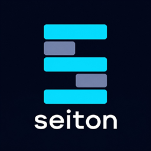

<p align="center"></p>

# seiton

[](https://github.com/u-kiyota/seiton/actions/workflows/ci.yml)

タブとブックマークを「ワークスペース」単位で整理し、まとめて切り替える Chrome 拡張機能です。仕事・案件・調べもの……と文脈ごとにタブを分け、いま必要なものだけを開いた状態で作業できます。

- Manifest V3。ビルド不要で、ソースをそのまま Chrome に読み込める
- データはすべてブラウザ内に保存。独自サーバー・アカウント登録・広告・トラッキングなし
- 対応ブラウザ: Google Chrome 121 以上（Chromium 系の Edge などでも動作するはずですが、確認しているのは Chrome です）。UI は日本語のみ

| | |
|---|---|
| Chrome ウェブストア | https://chromewebstore.google.com/detail/seiton/nekhambnhfgfbjmhmpngfbchclpenkof |
| 使い方ページ | インストール時に自動で開きます。設定・管理画面の「使い方を見る」、管理パネル左下の「? 使い方」からいつでも開けます |
| 仕様の詳細 | [docs/spec.md](docs/spec.md) |
| プライバシーポリシー | [store/privacy-policy.md](store/privacy-policy.md) |
| AI コーディングエージェント向けの案内 | [AGENTS.md](AGENTS.md) |

## できること

- **ワークスペース**: タブ構成（URL・タイトル・固定・タブグループ・前面のタブ）を作業ごとに保存し、ワンクリックやショートカットで切り替える。ブラウザを再起動しても、ウィンドウとワークスペースの対応を自動で復元する
- **休止して切替**: 入力途中のページを失いたくないときは、今のタブを閉じずに折りたたんだタブグループ「⏸ 名前」として同じウィンドウに残したまま切り替える
- **ブックマーク連携**: ワークスペースごとにブックマークフォルダを接続。`Ctrl+D` / `Alt+Shift+D` で保存したブックマークはそのフォルダへ自動で整理される。ブックマークするほどではないページは「よく開くタブ」置き場へ
- **クイックパレット（`Alt+K`）と管理パネル（`Alt+Shift+K`）**: 開いているタブ・接続フォルダのブックマーク・ワークスペース（権限を許可すれば Chrome の閲覧履歴も）をキーボードだけでインクリメンタル検索して開く / 切り替える
- **セッション（ログイン状態の切り替え）**: ワークスペースごとに「どのアカウントで使うか」を選ぶ（例: 本番用・開発用・個人用）。2 つ目のセッションを追加するときに権限を許可すると、切替時にサイトの Cookie を入れ替えてログイン状態を切り替える。退避した Cookie は AES-GCM で暗号化してブラウザ内に保存
- **メモリとタブの整理**: 遅延読み込み（ワークスペースを開くときは前面のタブだけを読み込む）、一定期間使っていないタブの自動クローズ（既定 OFF。除外 URL を指定でき、閉じたタブは履歴から開き直せる）、手動のメモリ解放
- **同期**: Chrome / Edge アカウントの拡張機能同期（`chrome.storage.sync`）で、別の PC でも同じワークスペースを再開できる
- **そのほか**: 複数のタブを別のワークスペースへ一括移動、ツールバーアイコンとウィンドウ左端の「ワークスペースタブ」で今のワークスペースを表示、番号キーでの切替、設定のエクスポート / インポート

> **セッションについて**: セッションはワークスペースを束ねる親ではなく、ワークスペース側が「このワークスペースはどのセッションを使う」と参照する関係です。AWS などのマルチアカウントをワークスペースごとに使い分ける用途を想定しています。

## インストール

### Chrome ウェブストアから（推奨）

1. [Chrome ウェブストアの seiton のページ](https://chromewebstore.google.com/detail/seiton/nekhambnhfgfbjmhmpngfbchclpenkof)を開き、「Chrome に追加」を押す
2. ツールバーのパズルアイコンから seiton をピン留めしておくと、ワンクリックでクイックパレットが開けて便利です

初回インストール時には使い方ページが自動で開きます。

### GitHub の Release から

ストアを経由せずに使いたい場合は、[Releases](https://github.com/u-kiyota/seiton/releases) の `seiton-v<version>.zip` を使います。

1. zip をダウンロードして展開する
2. `chrome://extensions` を開き、右上の「デベロッパーモード」を ON にする
3. 「パッケージ化されていない拡張機能を読み込む」で、展開したフォルダ（`manifest.json` がある場所）を選ぶ

ストア版と Release 版・ソース版は別の拡張として扱われ、保存データは共有されません（設定・管理画面のエクスポート / インポートで移せます）。

### ソースから

クローンしたフォルダをそのまま読み込めます。手順は下記「[開発](#開発)」を参照してください。

## 使い方

### まず最初に（3 ステップ）

1. **管理パネルを開く**: `Alt+Shift+K` を押すか、ツールバーの seiton アイコン → 右上の ☰。今のウィンドウの上に一時的なウィンドウとして開きます（タブは増えません）
2. **最初のワークスペースを作る**: 「ワークスペース」見出し右の ＋ を押し、名前（例: 案件A）とアイコンを決めます。すでにタブを開いているなら「今開いているタブをこのワークスペースにする」を選ぶと、そのまま引き継げます
3. **2 つ目を作って切り替えてみる**: もう 1 つ作ると、今のタブは閉じて新しいワークスペースに切り替わります。一覧の行をクリック、または `Alt+K` → `>` に続けて名前を打つと行き来できます。閉じたタブは失われず、戻ると復元されます

### 主な画面

- **管理パネル**（`Alt+Shift+K`）: ワークスペースの一覧・接続フォルダのブックマーク・開いているタブを並べて表示。上部の検索ボックスでワークスペース・ブックマーク・閲覧履歴をまとめて検索し、↑↓ と Enter で開く。＋ で作成、✎ で名前・色・アイコン・セッション・接続フォルダ・自動クローズの編集、行のドラッグで並び替え。行にマウスを乗せると ⏸（休止して切替）と ⧉（新しいウィンドウで開く）が出る。タブの行はチェックボックスで複数選んで別のワークスペースへ移動でき、ブックマーク一覧へドラッグするとブックマークに登録できる
- **クイックパレット**（`Alt+K`）: 開いているタブ・接続フォルダのブックマーク・ワークスペースをインクリメンタル検索。`>` または Tab でワークスペースだけの検索モード
- **設定・管理画面**（管理パネル左下の「⚙ 設定・管理」）: ワークスペース / セッション / 閉じたタブの管理と、表示・操作 / メモリ / タブの自動クローズ / ブックマーク / ショートカット / 同期 / バックアップの設定。左のサイドメニューで切り替える
- **ワークスペースタブ**: ワークスペースを割り当てたウィンドウのタブ列の左端に、今のワークスペースの色と名前のラベル（折りたたんだタブグループ）を常に表示。クリックするとワークスペース一覧とブックマークのページが開く。設定で OFF にできる
- **ツールバーアイコン**: ウィンドウごとに今のワークスペースの色とアイコンになり、ホバーで名前とセッション名が出る

### ショートカット

| キー | 動作 |
|---|---|
| `Alt+K` | クイックパレットを開く |
| `Alt+Shift+K` | 管理パネルを開く / 閉じる |
| `Alt+Shift+D` | 現在のタブをワークスペースの接続フォルダに保存 |
| `Alt+Shift+N` | 同じセッション内の次のワークスペースへ切り替え |
| 管理パネル / パレットで `Enter` | 既定の切替方法で開く（設定・管理の「表示・操作」で「切替 / 休止して切替 / 新しいウィンドウ」から選ぶ） |
| 同 `Ctrl+Enter`（Mac は `⌘+Enter`） | 「休止して切替」との入れ替え |
| 同 `Shift+Enter` | 「新しいウィンドウで開く」との入れ替え |
| 管理パネルで `1`〜`9`, `0` | 一覧の番号のワークスペースへ切り替え（`Shift` で新しいウィンドウ） |

ショートカットは `chrome://extensions/shortcuts` で変更できます。IME や他のアプリと衝突する場合はここで変えてください（「前のワークスペース」は既定キーなし）。

### 知っておくこと

- Chrome にはタブを「隠す」API が無いため、切替は「今のタブを保存して閉じ、切替先のタブを URL から開き直す」方式です。フォームの入力途中の内容・スクロール位置・タブごとの戻る / 進む履歴は引き継がれません。残したいときは「休止して切替」を使ってください
- セッション（Cookie の分離）は Chrome 全体で同時に 1 つだけで、切替は全ウィンドウに及びます。localStorage などサイト側の他の保存領域は分けません
- 同期は `chrome.storage.sync` の容量（100 KB）の範囲で行い、収まらない分は古いワークスペースからタブだけを省きます。退避した Cookie と閉じたタブの履歴は同期しません
- 未割り当てのウィンドウで別のワークスペースに切り替えると、そのウィンドウのタブは「未整理 M/D HH:mm」というワークスペースとして自動保存されます（タブを失わないため）
- シークレットウィンドウは対象外です。`chrome://` の一部は開けないことがあり、その場合は復元をスキップします
- ローカルファイル（`file://`）のタブは、拡張に「ファイルの URL へのアクセス」が許可されていないと開き直せないため、ワークスペースに保存せず、切替でも閉じずにそのウィンドウに残します。`chrome://extensions` の seiton の詳細で許可すると他のタブと同じように保存・復元されます

仕組みの詳細・データの保存形式・既知の制限は [docs/spec.md](docs/spec.md) にまとめています。

## 開発

### 準備

- Node.js 22 以上（テストと静的チェックに使います。依存パッケージは無いので `npm install` は不要です）
- Google Chrome 121 以上

```sh
git clone https://github.com/u-kiyota/seiton.git
cd seiton
npm test          # 純粋ロジックのユニットテスト（node --test）
npm run check     # manifest・参照ファイル・構文・import 名・_locales の静的チェック
```

### 開発中の拡張を Chrome に読み込む

1. `chrome://extensions` を開き、右上の「デベロッパーモード」を ON にする
2. 「パッケージ化されていない拡張機能を読み込む」で、クローンしたフォルダ（`manifest.json` がある場所）を選ぶ
3. コードを変更したら、同じ画面の拡張カードにある「再読み込み」（↻）を押す。サービスワーカーのログは「Service Worker」リンクから DevTools で確認できる

ストア版を入れたまま開発版を読み込むと、ショートカットが衝突してどちらかが効かなくなります。開発中はストア版を無効にするか、`chrome://extensions/shortcuts` でキーを変えてください。

### 構成

```
manifest.json          拡張の定義（name / description は _locales の __MSG_*__）
_locales/{en,ja}/      ストア掲載用の name / description
src/background.js      サービスワーカー。Chrome のイベントと UI からのメッセージを処理し、状態を書き込む唯一の場所
src/lib/               ロジック。core.js は chrome API に依存しない純粋関数、workspace.js が切替・保存・復元、ほか機能ごとのモジュール
src/ui/                管理パネル（sidepanel）/ クイックパレット（popup）/ 設定・管理（options, manage）/ ワークスペースタブ（wstab）/ 使い方（guide）
test/                  純粋ロジックのユニットテスト
scripts/               静的チェック（check.js）と配布用 zip の生成（build-zip.js）
store/                 Chrome ウェブストアの掲載文・プライバシーポリシー・スクリーンショット
docs/                  仕様の詳細と手動テストのチェックリスト
```

各ファイルの役割と保存データの形式は [docs/spec.md](docs/spec.md) の「構成」「データ」を参照してください。

### テスト

- `npm test` と `npm run check` は CI（GitHub Actions）でも PR ごとに実行されます
- 自動テストは Chrome API に依存しない部分だけを対象にしています。ウィンドウ・タブ・Cookie・同期・休止など実機でしか確認できない変更は、[docs/manual-test-checklist.md](docs/manual-test-checklist.md) の該当項目で確認してください

### リリース手順

1. `manifest.json` と `package.json` の version を上げてコミットする
2. `git tag v<version>` → `git push origin v<version>`
3. GitHub Actions がテストと静的チェックを実行し、配布用 zip（`seiton-v<version>.zip`）を作って Release に添付する（タグと manifest の version が違うと失敗する）
4. Chrome ウェブストアには同じ zip をアップロードする。ローカルで作るときは `npm run zip`（`dist/` に出力。Windows では PowerShell から実行する）。掲載文の原稿は [store/chrome-web-store-listing.md](store/chrome-web-store-listing.md)

### 貢献

issue を 1 つ選び、`main` から `feat/<issue 番号>-<短い英語>` のブランチを切って PR を送ってください。コードの約束ごとは [AGENTS.md](AGENTS.md) にまとめています。

## プライバシー

本拡張は、タブ・ブックマーク・設定などの情報をお使いのブラウザ内にだけ保存し、開発者や第三者のサーバーへ送信しません。同期を ON にした場合のみ、Google / Microsoft アカウントの拡張機能同期ストレージに保存されます。詳細は [store/privacy-policy.md](store/privacy-policy.md) を参照してください。

## ライセンス

[MIT License](LICENSE)
